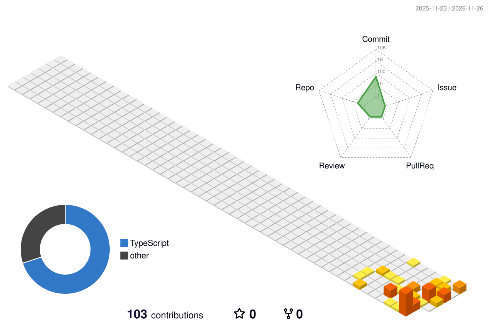

<!-- ===================================================== -->
<!--                 NUGUSA MULATU                         -->
<!--             GITHUB PROFILE README                     -->
<!-- ===================================================== -->

<!-- ANIMATED HERO HEADER -->

<!-- ANIMATED TYPING -->

 

---

<!-- ABOUT ME -->

<h2 align="center">✦ WHO AM I?</h2>

Hello! I'm **Nugusa Mulatu**, a Software Engineering student at **Jimma Institute of Technology, Ethiopia**.

I'm passionate about technology, programming, software architecture, and building digital solutions that make a difference.

I believe the best way to become a better developer is not just to consume tutorials, but to understand the fundamentals, experiment with ideas, and build real-world applications.

### 🚀 My Developer Identity

- 🎓 Software Engineering student at Jimma Institute of Technology.
- 💻 Interested in building modern software applications.
- 🌐 Exploring frontend and backend development.
- 🧠 Working toward expertise in AI, Machine Learning, and Computer Vision.
- 🔐 Interested in cybersecurity and software security.
- 🗄️ Exploring database engineering and system design.
- ⚡ Learning through projects, experimentation, and continuous improvement.

 

---

<!-- TECHNOLOGY STACK -->

<h2 align="center">✦ TECHNOLOGY ARSENAL</h2>

  <i>Technologies I use, study, and explore on my software engineering journey.</i>

### 01. Programming Languages

  

### 02. Frontend Development

  

### 03. Backend Development

  

### 04. Databases & Data Management

  

### 05. Artificial Intelligence & Machine Learning

  

### 06. Development Tools & IDEs

  

### 07. Operating Systems & Infrastructure

  

### 08. Cloud, Hosting & Deployment

  

### 09. Design & Creative Tools

  

  
  
  
  
  
  

---

<!-- PROJECT SHOWCASE -->

<h2 align="center">✦ FEATURED PROJECTS</h2>

  <i>Ideas transformed into working digital experiences.</i>

<table width="100%">
<tr>
<td width="50%" valign="top">

### 🌐 EZER TECH SOLUTIONS

A software services platform focused on practical technology solutions.

**Project areas**
- Operating system installation
- Software licensing
- Data recovery
- Computer repair and maintenance
- Technical service requests

</td>
<td width="50%" valign="top">

### 🍽️ SHAMBU FAST FOOD

A restaurant-oriented web project featuring a digital dining and ordering experience.

**Project areas**
- Restaurant menu presentation
- Food browsing
- Online ordering experience
- Digital restaurant interface

</td>
</tr>

<tr>
<td width="50%" valign="top">

### 📚 TEMARITUBE

A deployed web application and part of my ongoing journey in building digital products.

**Project focus**
- Web application development
- Digital user experiences
- Exploring practical product ideas

</td>
<td width="50%" valign="top">

### 🌍 TRANSLY

An AI-powered Ethiopian document translation project.

**Project focus**
- Document translation
- Language technology
- AI-powered applications
- Exploring language accessibility

</td>
</tr>
</table>

  <b>More projects, experiments, and ideas are coming.</b>

---

<!-- GITHUB ANALYTICS -->

<h2 align="center">✦ GITHUB ANALYTICS</h2>

  <i>A snapshot of my open-source activity and development journey.</i>

---

<!-- 3D CONTRIBUTION CALENDAR -->

<h2 align="center">✦ MY GITHUB CONTRIBUTION UNIVERSE</h2>

  <i>Every contribution represents another step in the journey.</i>

---

<!-- CONTRIBUTION SNAKE -->

<h2 align="center">✦ CONTRIBUTION SNAKE</h2>

  <i>Watch the snake travel through my GitHub contribution history!</i>

<picture>
  <source media="(prefers-color-scheme: dark)" srcset="https://raw.githubusercontent.com/nugusamulatu67-ux/nugusamulatu67-ux/output/github-snake-dark.svg"/>
  <source media="(prefers-color-scheme: light)" srcset="https://raw.githubusercontent.com/nugusamulatu67-ux/nugusamulatu67-ux/output/github-snake.svg"/>
  
</picture>

---

<!-- TROPHIES -->

<h2 align="center">✦ GITHUB TROPHIES</h2>

  

---

<!-- METRICS -->

<h2 align="center">✦ DEVELOPER METRICS</h2>

  <i>A deeper look into my GitHub development activity.</i>

  

---

<!-- CURRENT JOURNEY -->

<h2 align="center">✦ WHAT I'M CURRENTLY EXPLORING</h2>

<table width="100%">
<tr>
<td width="50%" valign="top">

### 🧠 Artificial Intelligence

- Python for AI development
- Machine Learning fundamentals
- Neural networks
- Computer Vision
- AI-powered applications

</td>
<td width="50%" valign="top">

### 💻 Software Engineering

- Full-stack development
- Software architecture
- Database engineering
- Data Structures and Algorithms
- Secure software development

</td>
</tr>
<tr>
<td width="50%" valign="top">

### 🌐 Web Technologies

- Modern frontend development
- Backend application design
- REST APIs
- Responsive interfaces
- Deployment and hosting

</td>
<td width="50%" valign="top">

### 🔬 Continuous Learning

- Problem solving
- Open-source development
- Building practical projects
- Exploring emerging technologies
- Improving engineering practices

</td>
</tr>
</table>

---

<!-- DEVELOPER MINDSET -->

<h2 align="center">✦ MY DEVELOPER MINDSET</h2>

  

| Principle | What it means to me |
|:---|:---|
| 📖 Learn | Understand the fundamentals. |
| 🛠️ Build | Turn knowledge into real projects. |
| 🧩 Solve | Approach problems with curiosity. |
| 🔄 Improve | Learn from mistakes and keep growing. |
| 🚀 Create | Build useful things that make a difference. |

---

<!-- CONNECT -->

<h2 align="center">✦ LET'S CONNECT</h2>

  I'm always interested in learning, sharing ideas, exploring technologies, and collaborating on meaningful software projects.

---

<!-- ANIMATED FOOTER -->

<h3>Thanks for visiting my GitHub profile! 💜</h3>

  

**© Nugusa Mulatu | Built with curiosity, creativity, and code.**

